# Hi, I'm Duda 👋🛰️

I'm a Computer Science student at UNIVALI who builds web apps at [Inover](https://github.com/dev-inover) with React, Next.js, TypeScript and Redux.

On the space side, I'm one of the telemetry managers at [LAPESP](https://github.com/LAPESP), my university's space research league, working on the part of the satellite that sends data back to Earth. I'm also a research scholar at **OESC**, the Santa Catarina Space Economy Observatory, a SpaceLab/UFSC project funded by FAPESC, where my research focuses on space systems, telecommunications and ground stations.

I like bold interfaces, low-level puzzles and projects with a bit of personality.

## 🧰 Stack

**Web, my daily driver**

**Low-level, embedded & everything else**

## 🛰️ Mission control

<b>📡 What I actually do up there</b>

 

- Design the telemetry board in **KiCad**: LoRa radio, SPI flash and the connectors to the rest of the satellite
- Write the firmware in **C on an STM32F411 with FreeRTOS**
- Worked on the **Ibeji** and **Qubit-II** missions and was part of the LAPESP delegation at **LASC 2026**

## 📊 Languages I use the most

## 💬 Say hi

Feel free to reach out in **Portuguese** or **English** 🇧🇷 🇺🇸

*see you in orbit* 🪐
